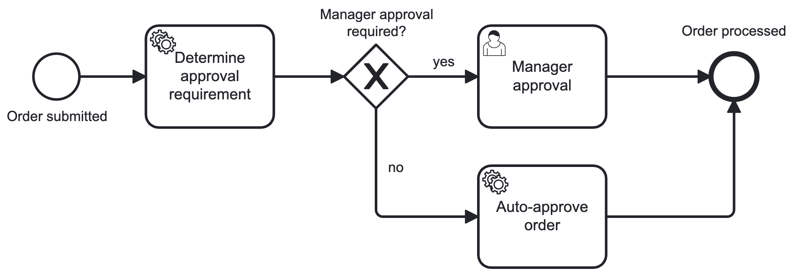
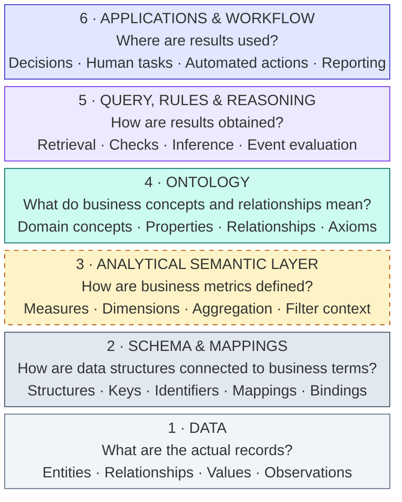
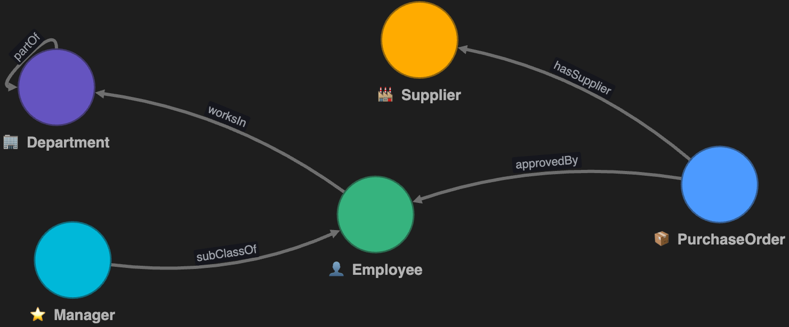

# decision-ontology-workflow-lab

A minimal but complete, consistent teaching package for ontology-grounded decision workflows: one business rule, expressed in a BPMN process, an OWL ontology, and a small relational dataset.

Technology scope: Ontology Playground, Stardog (Cloud Free: Studio, Designer, Explorer), Python (pystardog, martinlab-utils), BPMN (Camunda BPM 7 / CIB seven), CSV and plain SQL.

**Business rule:** Orders with an `amount` above 10,000 require approval by a *Manager*; orders at or below 10,000 are auto-approved.



## Conceptual architecture: from data to decisions

The six layers below separate responsibilities in this lab. They are a **teaching model**, synthesized from the sources below, rather than a standardized architecture or a mandatory processing pipeline. Layers can share an implementation; the analytical semantic layer is optional.



The stacked blocks group responsibilities; their vertical position does not prescribe execution order or require every application to pass through every layer. Ontologies and analytical models can be developed independently and connected through mappings. Applications can consume records, graph queries or analytical measures according to their needs.

### Connection to the purchase order use case

| Layer | Purchase order example | Existing lab artifacts |
|---|---|---|
| **6 · Applications & workflow** | Route a high-value order to a manager; coordinate the human approval task. | [Purchase order approval process](process/purchase-order-approval.bpmn). |
| **5 · Query, rules & reasoning** | Check whether an order above 10,000 has a manager approver; derive classifications and indirect department membership. | [Validation notebook](notebooks/validate_order_worker.ipynb), [rule definitions](ontology/procurement-rules.ttl), and the query examples below. |
| **4 · Ontology** | Define `PurchaseOrder`, `Employee`, `Manager`, `Supplier`, `Department` and relationships such as `approvedBy`, `hasSupplier` and `partOf`. | [Procurement ontology](ontology/procurement-ontology.rdf), also used for visual exploration. |
| **3 · Analytical semantic layer** | Define order counts and approved order value by department and currency. | [Analytical view](db/analytical_views.sql): a minimal SQL implementation of named metrics, not a complete BI semantic model. |
| **2 · Schema & mappings** | Connect order IDs, amounts and foreign keys to domain entities and properties. | [Relational schema](db/schema.sql) and `map:` annotations in the [ontology](ontology/procurement-ontology.rdf). The annotations document intended mappings; they do not execute them. |
| **1 · Data** | Actual purchase orders, employees, suppliers and departments, including pending order 1006. | [purchase_orders.csv](data/purchase_orders.csv), [employees.csv](data/employees.csv), [suppliers.csv](data/suppliers.csv), [departments.csv](data/departments.csv). |

### Optional paths and semantic boundaries

- **Direct ontology path:** ontology → mappings/bindings → data. An analytical semantic model is not required. Mapped graph data can be materialized or accessed virtually; the choice is an implementation detail.
- **Analytical path:** a domain ontology and an analytical semantic model can reuse compatible concepts and mappings. The latter adds metric and aggregation definitions; it is not a prerequisite for the ontology. Generating one model from another requires tool support and semantic review.
- **Meaning versus execution:** ontology axioms define logical meaning; inference requires an appropriate reasoner. Retrieval, validation checks, deductive inference and event-triggered actions are distinct mechanisms, even though they are grouped in layer 5 ([OWL 2 Primer](https://www.w3.org/TR/owl2-primer/), [SPARQL entailment regimes](https://www.w3.org/TR/sparql11-entailment/)). In this lab, the missing-approver query checks the available data. Under an open-world interpretation, missing information alone does not establish a logical violation.

### Where does the knowledge graph fit?

The **knowledge graph** is the connected representation of entities, relationships and facts used across these responsibilities. Here, instance facts are organized using the procurement ontology; queries may also expose inferred facts. A knowledge graph can use RDF or a labeled property graph. An explicit OWL ontology is not required by every definition or implementation of a knowledge graph; RDF/OWL entailment does not transfer automatically to a property graph. This distinction follows the broad treatment in [Hogan et al., *Knowledge Graphs*, ACM Computing Surveys (2021)](https://doi.org/10.1145/3447772).

**Example — order 1006:** the CSV provides an amount of 15,250 CHF and no approver (1); mappings identify the order and its properties (2); the ontology defines `PurchaseOrder` and `approvedBy` (4); the SPARQL check reports the missing manager approval in the available data (5); the BPMN gateway routes high-value orders to the manager task (6). Layer 3 is unnecessary for this check. For analytical spend totals across the sample's CHF, EUR and USD orders, group by currency or define currency conversion explicitly before aggregation.

## Repository structure

```text
decision-ontology-workflow-lab/
├── README.md
├── LICENSE                         # MIT
├── .gitignore
├── .env.example                    # credential variable names (no values)
├── process/
│   └── purchase-order-approval.bpmn          # external-task variant (1c)
├── ontology/
│   ├── procurement-ontology.rdf
│   └── procurement-rules.ttl       # Stardog-only reasoning layer
├── data/
│   ├── departments.csv
│   ├── employees.csv
│   ├── suppliers.csv
│   └── purchase_orders.csv
├── db/
│   ├── schema.sql
│   └── analytical_views.sql        # optional analytical semantic layer
└── notebooks/
    └── validate_order_worker.ipynb # runnable worker for variant 1c
```

## Artifacts

| File | Purpose |
|---|---|
| `process/purchase-order-approval.bpmn` | BPMN 2.0 process for Camunda BPM 7 / CIB seven: external service task `Validate order (SPARQL)` (topic `validate-order`), exclusive gateway (the decision), user task `Manager approval`, service task `Auto-approve order` (topic `auto-approve`). Opens in Camunda Modeler or bpmn.io. |
| `ontology/procurement-ontology.rdf` | OWL ontology (RDF/XML). `ont:` annotations (isIdentifier, cardinality, icon, color) follow the Ontology Playground conventions; `map:` annotation properties document the DB binding. Reasoning axioms (subclass, transitive `partOf`) are inert in flat tools. |
| `ontology/procurement-rules.ttl` | Stardog-only rule layer (Stardog Rule Syntax): derives `:HighValueOrder` and `:ApprovalViolation` memberships at query time. Not imported into the Playground. |
| `data/*.csv` | Instance data (English). FK integrity holds; `departments` includes a 3-level hierarchy (`parent_id`) for transitivity demos. |
| `db/schema.sql` | Matching relational schema incl. `CREATE DATABASE` (server-side; skip that section for the SQLite/sql.js import). Table names = CSV file stems = `map:sourceTable` values. |
| `db/analytical_views.sql` | Optional view defining procurement metrics by department and currency over the existing relational tables. |
| `notebooks/validate_order_worker.ipynb` | Runnable external-task worker for variant 1c (Deepnote-ready, env-var based). |

Naming conventions: table `purchase_orders` ↔ class `PurchaseOrder`; column `amount` ↔ property `amount`; PK column `id` ↔ `{Class}Id`; column `name` ↔ `{Class}Name`; `Manager` instances come from `employees` with row filter `is_manager=true` (or are inferred — see 1d).

---

## Business Process and Ontology

### Extend the BPMN model

The process model already contains the two extension points — no code here, pure modeling (Camunda BPM 7 / CIB seven external-task pattern):

- `Validate order (SPARQL)`: **external service task** with topic `validate-order`. The process engine only sees a topic; the implementation is provided later by the Python worker (variant 1c).
- `Manager approval`: **user task** for the human decision.

Open `process/purchase-order-approval.bpmn` in Camunda Modeler or bpmn.io and inspect the gateway conditions `${amount > 10000}` / `${amount <= 10000}` — the same rule reappears as SPARQL (1c) and as a Stardog inference rule (1d).

### Import and explore the ontology in the Ontology Playground

Fastest start — no import needed: [open the ontology directly in the Playground](https://microsoft.github.io/Ontology-Playground/#/share/eJytWF2OG7kRvkqh8yIBLUWbtXezGiTB_FjwYHc9jsdOHjKGUeouqbnDJtskW3LD2DNkFzlAgCDI214qJ8gRkmL_kC3NeHZjv0lsssiv6quqj3yfaOW01NsmWb5PFJaULJPnRme1oZKUg6v-c5rkZDMjKie0SpbJS8KsEGoLvQHYaAOuIHhem6xAS3BlcjJwWlVG71DCXpvbjdT7OZzVViiyFkwtaQma51nYC1cAKsBS18oBrvWO4LNFulgswNDbWhiCEhVuyQD2RieWCLboaI8N3CSn7drfd-v-cJOAUFB1J5r5nWb94vm6KtV0Di8Lght2xPImAVRKO2SQFibCXuaknNgIMilkaHKhUArXpCAyrVLItNRmChstpd579L3D4LnEZmt0rXL4NaxwbUQGl3-EFxcryLTasVmt7IlfdJOUWI13h8roiowTZHlj0_iJOTpcs2_XQuXs_YnDtSR_kLpUKRi9h42QjvypDGDtdIlOZFBiVfGKLSkyfos5vCC0Wgm1nRmStEN2-zuhSwsTW68zidam4AwqK5zYCddMAQ2BUGQcO3Yj0YHTWtplG_qAGVUeoRZlpY3zc0h6Zlk_Q2yVNuTH241P4NqhyfUWakuWP5RtjKtAyhnTxs6dkwPneAQkNmSm8yRN2LmuedlUZJPlX94nIk-WSc8CT8skHdh-MDym-elAnpamYOt1KZyjHNYNs5XKSuqGCJwGBFtXlRRk5i357c9j8QnYEqUk06cCO5kj11GVcgbFjPsfjP_8_W__StLEMy9ZJr96dP7V6WqVpEkgjMfcwfMWL_MkTVxT8YBQjrYeaczuZOlMTYfoXynxtiYQwzTQG8BDl0wqI0o0DdxSwxP6z29aNNN58n06nKfN7nCcnDJRojyuL9qh7DboKoJQPtZZbQyprIGt2JHiMIxGOzc0c7gwYtdyKNQL3s5yek1cYcgWWuZddKaekDy5Z6AnlSuQd95wWJ6KbfEnlHXLFSipXJOxhahGCPuTBIzWGaG2RxAvr6_g0W8--zKcPdM5sQf5FDH0FGi-ncP501UKT169SOHV9cVoz7c1esrfFebxps9qPjRvUivhbLsNEyyy5scu0FEUpvbf2BZPic66RxvSY2TQOnS1fdAh34gNZU0mCdoFI1csoSJf81LoswK0AUPfUdbu95p39KneJ2XI8idh5CjByVg9JHI-EEqXFaoG9oWGDFWH7ID7dpSYP_4zTszPvzj7_Msn9yZmf8ZPm5tRQTpMy_7DQUL2w8_470MRWtVSAi_sQ9OvPjCJQj5o68_a3IKfCpjnhvXAh4wWwtAv4eTgh--0UJTHMT0BUtw2LVhSQhvhGnhbkxFkRzTq6nRg0bfDwAGJIre3MqavN1i7wm8wh-uuozLKno5LEMo6VBm1RX-IUWtG2Dd9r_gdeBKA1WB81-aC5OtS2ySdhnW8Hi3sSco5XKpRUduhEcgVpcMSVTFPc5TWW5K0cVArVg3UdnO_maEcNkaXbddFtfVM6BPyrIny4d8__RCnw2Jx9tuLr-5Nhw7nJ-5UndUTsMzZHddusBVmxP4JGZiCFSobGvNhLCbDz7nIYV8Qa6DD0ExH1OmFQODOdRg5rEB9qfG9JicpdnyGrdY512ewZHYiI9sqVdZuLPwWs8fTgcdG2Nuewl2zKMS2mLWIO1Xh4yb1fmaQ9Ut_xHEN--tPcdBWq9OzxeLeoPUmPnHUerNHJWw48riE9cM_q4Q9i6rXsFEXgXEf585rHm7j5-28jhcjs8ICq_VxM2wD-LAC6gnTR9yHbzFfwKTSfOlwGh7zP3qXkZSk3PSERXPuRbEnBCqUjRW-4hzRYUTXnCo0jsV1IOxFPHZU77TZohLWXyRQejERbnBK1ShjyQ7rOt-Sm0MwavmcJSAUggyarGhgJxD489UGJsOtg6Zjfv4j5ucXjx8_Or-fnwHWJ2ZoMHzE0fDpgKXhwy_maVg6stg69WEmnd4Xj2P7LLLPn65OOCPWvm_6oPKkEJE-SCFywg2lqLNstJR1NWqrr9PEkGzv1oWooqvZoBrPmsC_8SCz_45LnNNjuRfd0dum0sycnml1LBS-EeqWL6GdeHV6rBpY9oW7nnAwWX19eLOZDxPesGjUEPeJLvgeX-iPAd5o7EPoggr5WHB9w2Jsd2loEG7OuiBHp037oKPvuMbe5Yne3B2OSENb1Uo20-jZAXIq9TLSEr0okeTsIFlaldMZKbTOI8nRvRvp2gG9q6TIhAPX8ENH5P4C7fVRPx4PfigAUS__mAjwbSt0tjvZ1H58I3KeH_rzmEz8jmYvVUASBjoUUT54AKPq_n9AiN84XEHCjOrf6uso3OFDhyIqhwc42iISYAz_OxSjU38MjqtxqwpVa01uT6TiM3o48ZkrNPeDgQvKJLImDsVxOeYti_RcGMpcrLQxM9pakLQjaU-ih7L-DeKuZ8ToES2uo4cPafF7Xfuq1rb6pHsz5Lr7-vv_AlxRwCY) (the ontology state is encoded in the URL fragment — no backend involved).

Manual import and exploration:

1. Open the [Ontology Playground](https://microsoft.github.io/Ontology-Playground/).
2. Import/Export → import `ontology/procurement-ontology.rdf`.
3. Explore: identifiers render with the 🔑 icon, relationships show cardinalities (note the self-relationship `partOf` on Department), classes show their icons/colors. Validation should report no issues.
4. Optional: re-export as RDF/XML. The transitivity axiom and the subclass axiom are ignored by the Playground's flat model — by design.



---

## Variant 1 — Stardog Cloud

All steps run in Stardog Cloud (free tier suffices: 1M edges, 3 databases).

### 1a. Ontology import (Designer)

1. In **Studio**: create a database `procurement`, then load `ontology/procurement-ontology.rdf` via the Database Hub (Load Data). Load it into the schema graph `tag:stardog:api:context:schema` so Designer can see it; the RDF/XML format is detected automatically.
2. In **Designer**: click the plus icon next to *Data Models* and import the model from the endpoint (server → `procurement` → schema). Alternatively, upload the model as a `.ttl` file directly in Designer.
3. If you build the model by hand instead, set the model namespace to `http://example.org/procurement#` (Designer's default is `tag:stardog:designer:<project>:model:`).

### 1b. CSV → graph mapping (Stardog Cloud, no code)

1. In Designer, add the four CSVs from `data/` as data sources (upload).
2. Map each CSV to its class: select the identifier column (`id`), the label and the attributes (`amount`, `currency`, `rating`, …); map the FK columns (`submitted_by`, `supplier_id`, `approved_by`, `department_id`, `parent_id`) as relationships. Designer suggests mappings in preview mode.
3. **Reasoning setup choice:** map `employees.csv` only to `Employee` and do *not* map a `Manager` subset — in 1d, Stardog will infer managerhood from the range of `approvedBy`. (Mapping the subclass explicitly via the `is_manager=true` filter is the alternative; compare both in class.)
4. **Publish** the project to the `procurement` database — publishing materializes the mapped data as RDF.
5. Verify in Studio or Explorer with query 1 from the gallery below (expected: orders 1002, 1004, 1006 on the manager path).

### 1c. External task worker with SPARQL (Deepnote notebook)

The implementation behind the BPMN topic `validate-order`, using `martinlab-utils` for the Camunda BPM 7 / CIB seven external-task client and `pystardog` for the rule check. Runnable version: `notebooks/validate_order_worker.ipynb`. Credentials live in Deepnote environment variables (Project settings → Environment variables; see `.env.example` for the variable names).

```python
# pip install martinlab-utils pystardog
import os
import stardog
import martinlab.camunda as cam

# --- connections (Deepnote env) ---
CONN = {
    "endpoint": os.environ["STARDOG_ENDPOINT"],    # https://<instance>.stardog.cloud:5820
    "username": os.environ["STARDOG_USERNAME"],
    "password": os.environ["STARDOG_PASSWORD"],
}
CAMUNDA_ENGINE_REST = os.environ["CAMUNDA_ENGINE_REST"]  # e.g. http://<host>:8080/engine-rest
TENANT_ID = os.environ.get("CAMUNDA_TENANT_ID")    # optional

# --- the business rule as a query ---
# A violation is a high-value order WITHOUT a manager approver.
ASK_VIOLATION = """
PREFIX : <http://example.org/procurement#>
ASK {{
  :purchase_orders/{oid} a :PurchaseOrder ; :amount ?a .
  FILTER(?a > 10000)
  FILTER NOT EXISTS {{ :purchase_orders/{oid} :approvedBy ?m . ?m a :Manager }}
}}
"""

def validate_order(task):
    order_id = int(task.get_variable("orderId"))  # adapt to martinlab-utils task API
    with stardog.Connection("procurement", **CONN) as conn:
        violation = conn.ask(ASK_VIOLATION.format(oid=order_id))
    return {"orderId": order_id, "valid": not violation}

# --- worker ---
worker = cam.Client(CAMUNDA_ENGINE_REST)
worker.subscribe("validate-order", validate_order, TENANT_ID)
worker.polling()
```

Expected behaviour with the sample data: order **1006** → `valid: False` (pending, 15,250 CHF, no manager assigned); order **1001** → `valid: True` (below threshold); order **1002** → `valid: True` (approved by a manager). With reasoning enabled (1d), the `?m a :Manager` check works even though no manager is explicitly typed in the mapped data.

`valid` is a diagnostic approval check: a pending high-value order can return false before the Manager approval task. The existing BPMN does not use it as a release gate. The example does not provide persistence of human decisions back to Stardog or CSV.

The code example and notebook retain their original implementation. They require verification against the external-task client API and a live Stardog/Camunda setup; the later callback corrections and regression tests are not included in this version.

Note: Stardog's built-in NL interface (Voicebox) requires a paid tier; the free tier is queried via SPARQL/pystardog as shown.

### 1d. Reasoning (Stardog only)

Stardog infers new facts at query time; the Playground ignores the corresponding reasoning axioms. Setup:

- Reasoning type `SL` (the database default) covers RDFS/OWL 2 profiles plus user-defined rules.
- Enable reasoning per query: Studio *Reasoning* toggle, HTTP parameter `reasoning=true`, or in pystardog `conn.select(query, reasoning=True)`.
- Load the rule layer: `ontology/procurement-rules.ttl` into the `procurement` database (Studio Load Data or `conn.add(stardog.content.File(...))`) — Stardog detects IF/THEN rules in Turtle files automatically.

| # | Demo | Mechanism | Reasoning OFF | Reasoning ON |
|---|------|-----------|---------------|--------------|
| R1 | Who is a manager? | `approvedBy` has range `Manager` | 0 rows (Manager never mapped) | Alice Smith, Dave Brown (inferred) |
| R2 | Managers are employees | `Manager rdfs:subClassOf Employee` | managers not in `:Employee` | included |
| R3 | Department hierarchy | `partOf` is transitive | direct parents only | full closure (5 → 1 → 4) |
| R4 | High-value classification | SRS rule 1 | no `:HighValueOrder` members | orders 1002, 1004, 1006 |
| R5 | Approval violations | SRS rule 2 (composes with R1 + R4) | none | order 1006 |

```sparql
-- R3: departments belonging to Corporate, directly or indirectly
PREFIX : <http://example.org/procurement#>
SELECT ?name ?budget WHERE {
  ?d :partOf :departments/4 ; :departmentName ?name ; :budget ?budget .
}
-- OFF: Procurement, Engineering, Finance (direct children)
-- ON:  + Indirect Procurement (via Procurement)

-- R3b: budget rollup over the hierarchy
PREFIX : <http://example.org/procurement#>
SELECT (SUM(?b) AS ?totalBudget) WHERE {
  ?d :partOf :departments/4 ; :budget ?b .
}
-- OFF: 900,000 | ON: 980,000

-- R4/R5: rule-derived classifications
PREFIX : <http://example.org/procurement#>
SELECT ?o WHERE { ?o a :HighValueOrder }       -- ON: 1002, 1004, 1006
SELECT ?v WHERE { ?v a :ApprovalViolation }    -- ON: 1006
```

Punchline for the course: with rule 2 loaded, the validation check in 1c collapses to `ASK { :purchase_orders/1006 a :ApprovalViolation }` — the business logic moves from the query into the knowledge graph itself. The derived classes `:HighValueOrder` and `:ApprovalViolation` are deliberately *not* declared in `procurement-ontology.rdf`, so the Playground import stays clean (declared entity types there require identifiers and bindings).

Compatibility notes: the Playground imports `partOf` as a normal self-relationship and ignores `owl:TransitiveProperty`; the subclass axiom is likewise ignored by flat models. The rules file is Stardog-specific (SRS; Stardog can translate to SWRL where expressible).

---

## SPARQL query gallery

```sparql
-- 1. The BPMN decision as a query: which orders take the manager path?
--    Expected: 1002, 1004, 1006
PREFIX : <http://example.org/procurement#>
SELECT ?order ?amount ?currency ?manager WHERE {
  ?order a :PurchaseOrder ; :amount ?amount ; :currency ?currency .
  OPTIONAL { ?order :approvedBy ?manager }
  FILTER(?amount > 10000)
} ORDER BY ?order
```

```sparql
-- 2. Rule violations (the check behind "Validate order (SPARQL)").
--    Expected: 1006. In Stardog, run with reasoning=ON so that
--    "?m a :Manager" is inferred from the range of approvedBy.
PREFIX : <http://example.org/procurement#>
SELECT ?order ?amount ?status WHERE {
  ?order a :PurchaseOrder ; :amount ?amount ; :status ?status .
  FILTER(?amount > 10000)
  FILTER NOT EXISTS { ?order :approvedBy ?m . ?m a :Manager }
}
```

```sparql
-- 3. Risk analysis: high-value orders from low-rated suppliers.
--    Expected: 1006 (Global Office Supplies, rating 3.1)
PREFIX : <http://example.org/procurement#>
SELECT ?order ?amount ?currency ?name ?rating WHERE {
  ?order a :PurchaseOrder ; :amount ?amount ; :currency ?currency ;
         :hasSupplier ?s .
  ?s :supplierName ?name ; :rating ?rating .
  FILTER(?amount > 10000 && ?rating < 3.5)
}
```

```sparql
-- 4. Reasoning demo: managers are employees (Manager rdfs:subClassOf Employee).
--    With reasoning enabled, Alice Smith and Dave Brown appear even where
--    only typed as :Manager (or only inferred via approvedBy).
PREFIX : <http://example.org/procurement#>
SELECT ?person ?name WHERE {
  ?person a :Employee ; :employeeName ?name .
} ORDER BY ?name
```

## Optional exercise — analytical semantic layer

The [analytical view](db/analytical_views.sql) adds reusable metric definitions over the existing tables. It is independent of the ontology and workflow: no changes to the RDF model, CSV files, notebook or BPMN are needed.

1. Create the tables with `db/schema.sql` and import the four CSVs into their matching tables (headers are column names; empty fields become NULL). For SQLite/sql.js, skip the server-side database setup in `schema.sql`.
2. Run `db/analytical_views.sql` once in the same database to create `procurement_metrics`.
3. Query the defined metrics:

```sql
SELECT department_name, currency,
       order_count, pending_order_count, approved_order_value
FROM procurement_metrics
ORDER BY department_id, currency;
```

Each row represents the submitting employee's directly assigned department and one currency. `order_count` counts all orders, `pending_order_count` counts orders with status `pending`, and `approved_order_value` sums amounts with status `approved`. The last metric reflects the recorded status, not a separate authorization check or actual expenditure. Missing department assignments remain in a NULL department group. There is no hierarchy rollup or currency conversion; do not sum monetary values across currencies.

With the supplied CSVs, Procurement/CHF has two orders, one pending order and an approved order value of 12,500.00 CHF; Engineering/CHF has two orders, none pending and an approved order value of 10,849.99 CHF.

**Student task:** predict the results before running the query, then explain why pending and rejected orders count toward `order_count` but not `approved_order_value`. Discuss how the metric definition would change if the business wanted the value of pending orders instead. This view demonstrates layer 3 through explicit metric definitions; it does not implement a full BI semantic model or an ontology reasoner.

## Teaching notes

- The business policy is reflected in process routing, query-based checks, and rule-based classification. These mechanisms address different aspects of the policy and are not interchangeable.
- With the same ontology and data, Stardog derives new facts through subclass, range, transitivity and rules; the Ontology Playground provides a visual model.
- Edge cases in the data: order 1005 (9,999.99 — just below the threshold), order 1006 (pending high-value, low-rated supplier — the risk case and the rule violation), order 1004 (rejected by a manager).