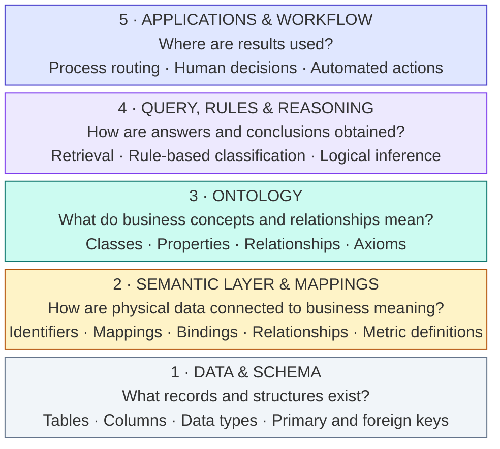

# decision-ontology-workflow-lab

Explore a procurement ontology, connect CSV data to business concepts, derive an approval requirement and use it in a BPMN workflow.

**Scenario:** order 1006 is pending and has an amount of 15,250 CHF. Does it need manager approval? The ontology describes the order and its relationships; a business rule classifies it as a `HighValueOrder`; a SPARQL query returns `approvalRequired`; BPMN routes on that result. Changing the rule changes the workflow decision without changing Python or BPMN.

## Architecture

These five layers are a teaching model. Layer 2 is the required bridge from source records to business concepts; analytical metrics complement the mappings.



| Layer | Lab artifacts |
|---|---|
| 1 · Data & schema | [CSV sources](data/), [SQL schema](db/schema.sql) |
| 2 · Semantic layer & mappings | [Designer project](ontology/Procurement.stardogdesigner), [analytical SQL view](db/analytical_views.sql) |
| 3 · Ontology | [Procurement ontology](ontology/procurement-ontology.rdf) |
| 4 · Query, rules & reasoning | [Business rules](ontology/procurement-rules.ttl), SPARQL in [the notebook](notebooks/validate_order_worker.ipynb) |
| 5 · Applications & workflow | [BPMN process](process/purchase-order-approval.bpmn), notebook worker |

The mappings perform **semantic lifting**: they turn rows and foreign keys into identified business objects and relationships. The resulting **knowledge graph** connects these facts using the ontology; it is not an additional layer. The SQL view defines metrics, while the Designer mappings connect individual records to ontology concepts.

## Lab walkthrough

You need the repository files, a Jupyter-compatible environment, access to Stardog Designer, Explorer and Studio, and access to the course CIB seven engine. Keep the notebook open: use section A in step 2 and section B in step 6. Stardog credentials and the engine tenant ID are entered interactively.

### 1. Explore the ontology in the Ontology Playground

Open the [Ontology Playground](https://microsoft.github.io/Ontology-Playground/) and import [procurement-ontology.rdf](ontology/procurement-ontology.rdf). Alternatively, [open the visual model directly](https://microsoft.github.io/Ontology-Playground/#/share/eJytWOtuHLcVfpWD7R8JWG02jZ3LCkGhiwULbSzHstsftSFwZ7i7jGfIMTkjZWLkGdIiD1CgKPovL9Un6CP0O5zhkLMrRY7VHwK05Jlz_c6N7ydG16Yw63ayeD_RopSTxeS5NVljZSl1TRfhejrJpcusqmplNIheSpFtlF5TYEArY6neSHre2GwjnKQLm0tLR1VlzbUo6MbYt6vC3MzouHFKS-fINoVckGE6Rzeq3pDQJErTQLJYmmtJn86n8_mcrHzXKCupFFqswVQEpntOSlqLWt6Ill5Pvtm-7z_M__B6QkpT1et24GUeBLLZsir1_oxeQv3X7JIFyIXWphZsrqM95c5z-EOtlLRTyoTNlRaFqtspqcxoHMEJdh9OKGCi90NwHT0vRLu2MCqnT-hMLK3K6PxbenF6hq_0NbOFjEP_0etJKaqxdIKOlbS1ko4F29YT5qIWS_byUumc47CH34X0ijQlFLJQY6WKWkIr4ShHTDmiHcsQK9dUVaFkTqfSqbWG5yC-Ajs3oxdSOKPx_4GVhbwWHJPvlSnhDdcss0I4N6XaCu1Ura7hCshBiBBZW7OvV4WoqTamcIsOF9ENAn_REaqsDD5hGghiJZ2ngEIGDPm8E3xIlzU8b9bUODgDF2UHgCoi9oAx5WZ1XQxG8glBODwxA47Z33X7sq2kmyz--n6icsA5AMNjFkQhFbaOxzlwNOCpwzDcuSxVXcOfy5ahLMuqMC0UrA2J4Gw76zLDfRjED8mVoihw0ucJO1k0tenRK3M2ikEIjf77j5__jV8ejPj5u0cnXx2dneEkYsjb3JvnOZ7nuK_hDhwoXcv1LZa-0updg9gOOUBmBYu2zN-rrCoFAPpWtkwQrq86zb3300SaLGrbyB-ngz5d6kd1cpmBYbFbfJAaRS-0LxcAHMcaMLBSZy2tFRKLwzA67d3QzujUgsB14ArFgsU5To-9emOl25gi76Oz7wHJxAGBHlT1RrDkFYflqVpv_iyKpsMKlbJc4nijqtkksTBoEm10tUWO7Zh4fnlBj37_6RdR98zkkr3KWqSmT0nO1jM6eXo2pSevXkzp1eXpSOa7RnjI3x_mZw0rzUIarZCFXgwDLOHmz05RcZMwdb_GvJgk0fUGNWhIjxFDh5rUuHsd8ie1klmbwevdByNXLKiSvgxOKWQFLpBT38msk_eGJfpUD0kZs_xJPNlJcMTQDImcD4AyZSV0Szcbg5qse8u28sGNEvPv_0oT87PPjz_74smdiRl0_PjcTIrPdlqGiw9IyED6jH_eF6GzpiiIPwyhCV-Pwi1LoYp7ef0FwwJ5UhJ5bnlY-DWmG1TO34LJwTffGfSrPI3pIUnNnRRwlVoZi8Qh-NciQiMY9XU6ouib4WALREkouhkn1BtU8Y0XMKPLvqOylQGOC5QWYF1nsiv6Q9w6NspdhV7xNXHcpuQMIM9dmwuSr0tdk0T7WabfIxdvZFHM6ChoAG4kHY8Qym3gEAwVklMKyChaRv3w8SzK_bqTquU1BHUdLxm8im528hVwyIP__PK3NA3m8-MvT7-6Mw16OQ_oUD0HNFHG5TXXZ3KVyCT7IGYZXKfg50C-7e-9xPocSS95ztl2_13ZFCETBoCImct4sl15QonxPSaXBdoV9Fobk3NdBjjttQIyuqHVwtc8A84PHu8P-LXKvQ3Q7ZvEBk3qoPNCP02srCkJI-sBWCDuQcVx7frplzRoZ2dHx_P5nUELLB4QtcBip3QN6t1fugLpB5WuZ0nVGoT3ERj3b-649v72fdLR9VgZsUWm8eA-boJdAO-ffAJgQsR9-OazOTxleP9Apj_mX_L7DAkO5-wf8rCc-2HYAwKYLVqnfKXZgcOowqECCFvzUB0Be5qe7dQ5Y9dCK-cTHzWAh4i41mnd4CwZ1WnZ5GtZYxYbmDrWswQCNrBRoJm2dK0wZ-L6YoWxLGwbfbIN-Pxnis_PHz9-dHI3PqNZD0BoZLKD0Xj1ASiNxL8Zp_HTEZI6p96PpKO74rHLn4drjJeHnBFL3y99UJkoRiQEKUYOwQ-lqOdssR031aidvplO0laRrGTDtHjcRvyNDxn9tyxvtRmPecm63jWV9gDrE7rkLUOmfsvLZz-0IptG0wKPe3HHg317Z3_c3nJmA8EVD4sm7Zz5fhcqb18YVFPzRmf_d-teyAw6Ol7cTB-0oV9vLay3GRaUu9Uuet4N4H5RCnN3aDIbAVHabIvlVfhpLEFBFzfswuMpJJ1PhoeeMMB0zydhdEJ51GtA2AB72tS0tvx84VtpHLpiKGDl5U5vHh_-WjCSvv4QqPHGFTvfrcjqLq8whNQm6dVjYPFDmzvX0ZJ40FuRoMcbMKr0H2FC-s6BMCg7qo-wJGIlXvRWJOVyy46uoEQzht-9FSOtH2LHxbhtxQq2lPWNlDrV0ZuT6oz_7jYGrQ1jveUNYyiUi-ENoX854Ac8i3xJ3gxIZNZgGygwWhfuMHksC-8Qt70uJg9paU3dfkxL3-y6l7XE6aheJ7yIXKzCeHu1uzBHohiNuA99fIHyTDGfo2WB_AdvwYJ4vWiHjFcecUOi79l85RZRIf-KCxomo26l8iZOfR3Al2GnOvC-JbPkUhUfhvwANOkfVbkbvfnxfyMTMOM); the share link contains the visual projection rather than the complete RDF source.

Find `PurchaseOrder`, `Employee`, `Manager`, `Supplier` and `Department`. Follow `submittedBy`, `hasSupplier` and `approvedBy`. Notice that `Manager` is a subclass of `Employee` and `partOf` is transitive.

`approvedBy` records a positive approval. Manager authority comes independently from `employees.is_manager=true`; a missing approval on a pending order is expected.

**Discuss:** what describes an order, and what additional policy is needed to decide whether it requires approval?


### 2. Inspect CSV sources, build the SQL schema and inspect the semantic layer

Open [the notebook](notebooks/validate_order_worker.ipynb) and run **section A (A1–A4)**. It displays the four CSVs, creates the SQL tables in memory, checks foreign keys and queries the analytical view. No Stardog connection is needed yet.

Trace an order through its submitting employee to its department. Inspect the view's three metrics: all orders (`order_count`), pending orders (`pending_order_count`) and the sum of approved amounts (`approved_order_value`). Results are grouped by directly assigned department and currency, without currency conversion or hierarchy rollup.

**Check:** Procurement/CHF has 2 orders, 1 pending and an approved value of 12,500.00 CHF. Why does a rejected order count as an order but contribute no approved value? Stop before section B.

### 3. Import the ontology and mappings into Stardog Designer

Import [Procurement.stardogdesigner](ontology/Procurement.stardogdesigner) as a **Designer project** and select your Stardog connection. It contains the ontology projection, mappings and CSV snapshots. Review the prepared mappings rather than generating a new model from CSVs.

Trace `purchase_orders.supplier_id` → `hasSupplier` → `Supplier`. The embedded `managers` resource contains only employees with `is_manager=true`; it shares their employee identifiers so each person remains one entity.

Publish to database **`procurement`** using these data graphs; the notebook queries their union:

| Resource | Data graph |
|---|---|
| departments | `http://example.org/procurement/data/departments` |
| employees | `http://example.org/procurement/data/employees` |
| managers | `http://example.org/procurement/data/managers` |
| purchase_orders | `http://example.org/procurement/data/purchase_orders` |
| suppliers | `http://example.org/procurement/data/suppliers` |

In Studio, also load [procurement-ontology.rdf](ontology/procurement-ontology.rdf) into schema graph `tag:stardog:api:context:schema` and select it as the active reasoning schema. This preserves the complete OWL axioms beyond Designer's editable projection. Use a fresh lab database to avoid mixing earlier model versions.

**Check:** missing foreign keys create no relationship. If you change a CSV later, update its embedded Designer resource as well, including the filtered Manager subset.

### 4. Explore the populated ontology in Stardog Explorer

Open `procurement` in Explorer and select the published model and data graphs. Find order **1006** and follow its supplier, submitting employee and department. Compare it with order **1002**, which has a positive approval by Alice, and rejected order **1004**, which has no approval edge.

**Check:** 6 PurchaseOrders, 4 Employees, 2 Managers, 3 Suppliers, 5 Departments and one `approvedBy` relationship. Managers are also Employees, not additional people.

**Discuss:** describe order 1006 using the connected business facts. What becomes easier to understand than in the separate CSVs?

### 5. Extend rules and test SPARQL in Stardog Studio

Load **only `ApprovalRequirementRule`**, the first rule in [procurement-rules.ttl](ontology/procurement-rules.ttl), into `tag:stardog:api:context:schema`. It classifies orders above 10,000 as `HighValueOrder`. This simplified policy applies the threshold separately in each currency.

Run this query with reasoning **off**, then **on**:

```sparql
PREFIX : <http://example.org/procurement#>
SELECT ?order
FROM <http://example.org/procurement/data/purchase_orders>
WHERE { ?order a :HighValueOrder }
ORDER BY ?order
```

**Check:** no results without reasoning; orders **1002, 1004 and 1006** with reasoning. The classification expresses an approval requirement, independently of an order's recorded status.

For an ontology inference, query the department hierarchy:

```sparql
PREFIX : <http://example.org/procurement#>
SELECT ?department
FROM <http://example.org/procurement/data/departments>
WHERE { ?department :partOf <http://example.org/procurement#departments/4> }
ORDER BY ?department
```

**Check:** departments 1, 2 and 3 without reasoning; additionally department 5 with reasoning, through transitive `partOf`.

**Experiment:** lower the threshold to 4,000 and predict which orders now qualify. Replace the existing named rule rather than adding a second version. Remove its stored statements with this update, then load the revised rule:

```sparql
PREFIX : <http://example.org/procurement#>
DELETE WHERE {
  GRAPH <tag:stardog:api:context:schema> {
    :ApprovalRequirementRule ?predicate ?value .
  }
}
```

Restore **10,000** before step 6. The second rule, `ApprovalViolation`, is an optional exercise requiring `reasoning.stride=true`; it is not needed for this workflow.

### 6. Run the external service tasks and BPMN workflow

Return to **section B** of [the notebook](notebooks/validate_order_worker.ipynb):

1. Run **B1–B2** and enter the Stardog endpoint, database username and password. Use the database endpoint rather than the cloud portal URL.
2. Read the standard SPARQL query and `check_order` in **B3–B4**. The query retrieves inferred membership; Python passes the result to the process without evaluating the threshold.
3. Run **B5** with the baseline rule: order 1003 returns `false`, order 1006 returns `true`. Resolve any failed check before starting the worker.
4. Run **B6** to define the callbacks. Deploy [purchase-order-approval.bpmn](process/purchase-order-approval.bpmn), then run **B7**, enter your tenant ID and start a process instance with an integer `orderId`. The REST URL is already set to `https://digibp.engines.aisl.science/engine-rest`.

| Order | `approvalRequired` | Expected path |
|---|---|---|
| 1003 · 4,200 EUR | `false` | Automatic approval |
| 1006 · 15,250 CHF | `true` | Manager approval |

The external task `validate-order` supplies `approvalRequired`; the gateway routes on that Boolean. The `auto-approve` worker handles the automatic path.

**Experiment (B8):** replace the rule with a threshold of 4,000 and start a new instance for order 1003. It now takes the manager path, using the same query, Python code and BPMN model. Restore the original rule afterwards. Interrupt notebook polling to stop the worker.


This lab demonstrates routing: decisions update process variables, not the CSVs or Stardog data. Worker errors create incidents. PNGs are illustrative snapshots; RDF and BPMN files are authoritative.
